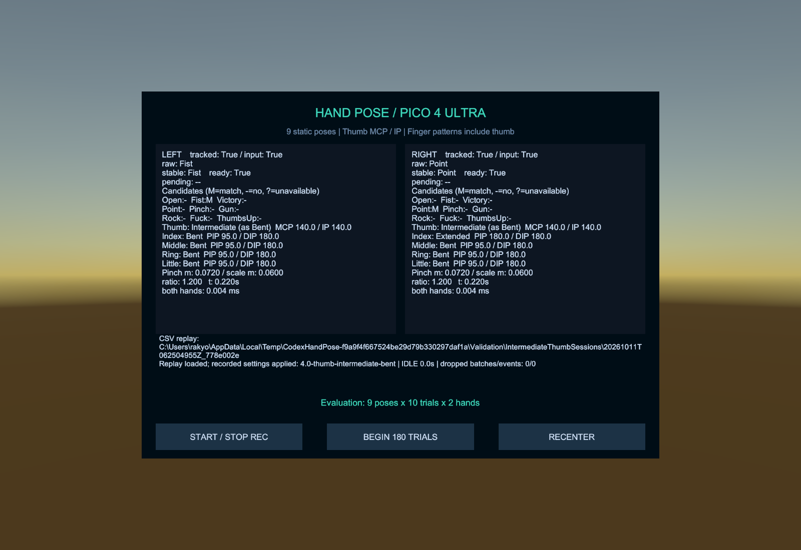
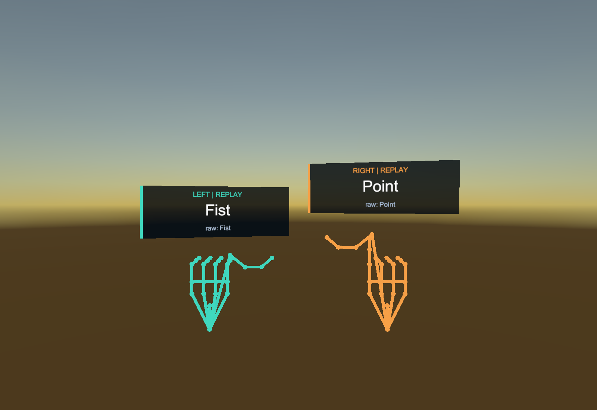

# 親指Intermediateを判定上Bentとして扱う変更 — 2026-10-11

対象は `F:\LaboLatry\UItry`。Unity 6000.0.38f1／PICO Integration SDK 3.4.0を使用しています。

## 変更後の扱い

| 親指の実測状態 | ポーズ照合に使う状態 |
|---|---|
| Extended | Extended |
| Bent | Bent |
| Intermediate | Bent |
| Invalid | Invalid（判定不能） |

親指だけを変換します。他4指のIntermediateは従来どおりExtended／Bentのどちらにも一致しません。親指のMCP/IP角度と実測の状態を保持し、判定に使う状態を `RuleResult.ThumbRuleState` へ分けました。

他の指が各ポーズの条件を満たせば、親指IntermediateでFist／Victory／Point／Rock／Fuckが成立します。Open／Gun／ThumbsUpには親指Extendedが必要です。Pinchの距離・ヒステリシス、優先順、左右独立の安定化、欠損の扱いは維持します。

モニターは `Thumb: Intermediate (as Bent)` と表示します。CSVのthumb_stateは実測のIntermediateを保存し、角度を変更しません。新規記録はschema_version=2／rulesVersion=4、既定の設定名は `4.0-thumb-intermediate-bent` です。列構成は変えず、保存したルール版から判定時の扱いを再現します。

旧ライブ設定はしきい値・優先順を保持して版4へ更新します。旧CSVは保存時の版1／2／3で再生し、当時の定義を維持します。版3のIntermediateはBentとして扱いません。

## ソフトウェア検証

**Unity EditMode 90/90成功**。従来72件を更新し、18件を追加しました。

- 左右のFist／Victory／Point／Rock／Fuckが親指Intermediateで成立し、安定化すること。
- Open／Gun／ThumbsUpが親指Intermediateでは成立せず、Gunの指パターンはPoint、ThumbsUpの指パターンはFistになること。
- 親指の実測状態IntermediateとMCP/IP角度が変換されずに残ること。
- 他4指のIntermediateと、欠損によるInvalidをBentへ変換しないこと。
- 旧ルール版2／3での非変換、版3ライブ設定の移行、版3／4のCSV記録・再生と実測値の保持。

**Unity PlayModeの表示・CSV再生検証も成功**。保存済みデモシーンで9ポーズを左右別々に安定化させ、手元ラベルとの一致を確認しました。親指Intermediateを記録したCSVの再生では、左Fist／右Pointの成立、実測値の保持、モニターの `Intermediate (as Bent)` 表示を確認しています。

新版の9ポーズ合成サンプルは左右各9件、計18試行がすべて成功しました。420バッチを集計し、記録の欠落は0です。これらはソフトウェアの動作確認であり、実機の認識精度を示す値ではありません。

## 表示例

親指MCP/IPが約140度の合成記録を再生します。左右とも実測はIntermediateで、左Fist・右Pointとして照合します。

`Samples/IntermediateThumbSessionV4` はこの表示確認用の3バッチ、左右各26点の記録です。通常の9ポーズの合成サンプルは `Samples/SyntheticSessionV4` です。合成入力の成功は実際の手追跡精度を示しません。PICO実機の認識精度・表示の読みやすさ・しきい値調整は未確認です。

## Android成果物と証跡

更新APK：`Builds/HandPose-PICO4Ultra-ThumbIntermediateBent.apk`（検証用デバッグ署名）。元のプロジェクトの独自署名設定と以前のAPKは保持しています。ビルド結果・SHA-256は `Builds/thumb-intermediate-build-result.txt` に保存します。

Android ARM64／IL2CPPのビルドは成功し、エラー0件、警告12件でした。APKは77,592,776バイトで、APK Signature Scheme v2の検証に成功しています。Core／Runtime、保存済みデモシーン、既定設定の計22ファイルがビルド用コピーと一致しています。

SHA-256：`5785A267EAF8788CFDFB6C27AEA3357222CEC0D157B6D1872C06F2D0646F11BD`

| 証跡 | 内容 |
|---|---|
| Validation/Logs/thumb-intermediate-editmode.xml | 90テストの結果 |
| Validation/Logs/thumb-intermediate-editmode.log | コンパイル・テストログ |
| Validation/Logs/thumb-intermediate-ui.log | 保存済みデモシーンでの表示検証 |
| Validation/Logs/thumb-intermediate-ui-smoke.txt | 親指Intermediateの記録再生・手元ラベル・モニターの確認 |
| Validation/Logs/sample-analysis-v4/ | 9ポーズの合成記録の集計 |
| Validation/Logs/thumb-intermediate-android-build.log | Androidビルドログ |
| Validation/Logs/thumb-intermediate-source-manifest.json | ビルド用コピーとのソース照合 |

親指の必須条件を追加した旧版3については [THUMB_REQUIRED_VALIDATION.md](THUMB_REQUIRED_VALIDATION.md) を参照してください。
