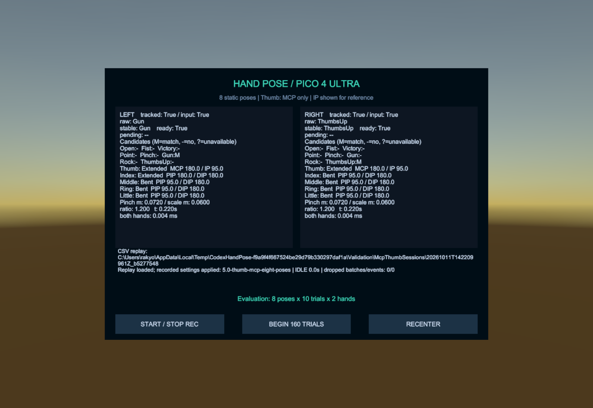
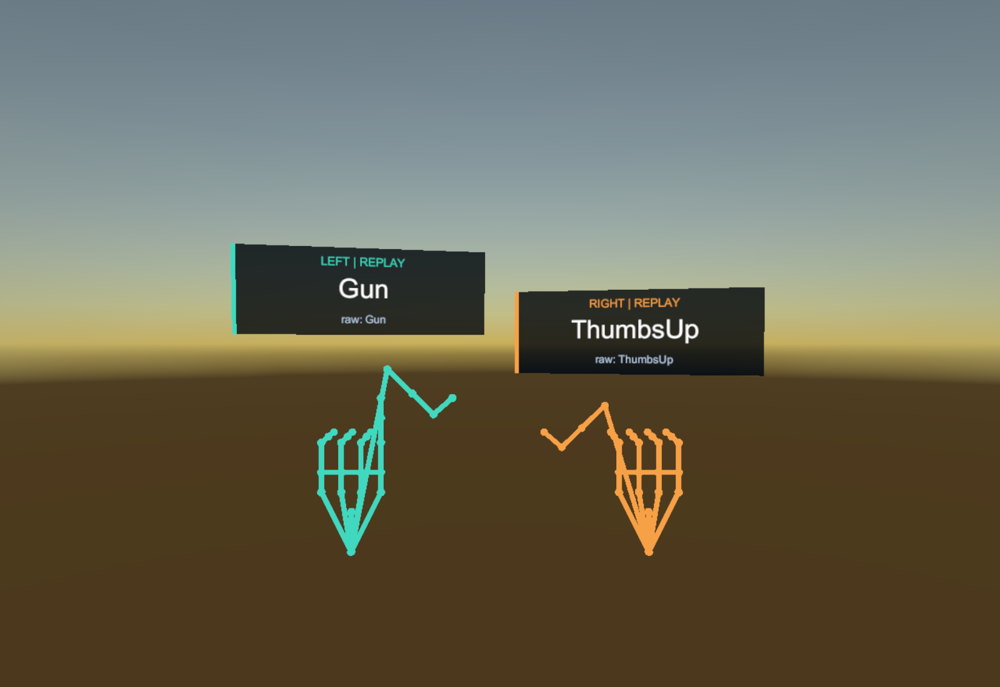

# 親指MCPのみの判定と8ポーズへの変更 — 2026-10-11

対象は `F:\LaboLatry\UItry`。Unity 6000.0.38f1／PICO Integration SDK 3.4.0を使用しています。

親指は **MCP（metacarpal／proximal／distalの3点から求める付け根側の内角）だけ**で分類します。既定値はMCPが150度以上でExtended、125度以下でBent、その間はIntermediateです。角度境界には0.0001度の誤差許容があります。IP角度は表示とCSV記録に残し、親指の状態分類や有効性判定には使いません。

Intermediateをポーズ照合時にBentとして扱う変更は維持します。実測状態はIntermediateのまま保存します。他4指の分類方法としきい値は変えません。MCPの欠損・計算不能はInvalidであり、Bentには変換しません。Pinchは従来どおり親指先と人差し指先の距離で判定するため、指先の位置も必要です。

**Fuckを現在の認識ルール、優先順、候補表示、合成入力の選択・巡回、Inspectorの選択肢、評価指示から削除**しました。現在の対象はOpen／Fist／Victory／Point／Pinch／Gun／Rock／ThumbsUpの8種類です。中指だけをExtendedにした旧パターンは、他の条件に一致しなければOtherになります。評価は8種類×10回×左右＝160試行です。

新規記録はschema_version=2／rulesVersion=5、設定名は `5.0-thumb-mcp-eight-poses`。poses.csvの候補列からcandidate_fuckを除き、親指のMCP／IP角度は両方保存します。旧記録は保存時の版1～4を適用し、当時の2角度判定とポーズ集合で再生します。旧記録の数値ID=9は互換性専用に保持します。旧ライブ設定は削除ポーズを除いて版5に更新し、残る優先順としきい値を保持します。

## 検証結果

**Unity EditMode 101/101成功、Python集計テスト9/9成功、Unity PlayModeの表示・CSV再生検証成功**。

- 左右のMCP／IP角度を独立に変え、MCPだけが実測状態を決めること。MCP＝180度・IP＝95度ではGun、MCP＝140度・IP＝180度では実測Intermediate／照合BentのPointとして安定化します。
- IP角度が計算不能でも、有効なMCPの状態とGun候補が保持されること。MCPが欠損した場合は判定不能になること。
- 8ポーズの指パターン、削除ポーズのOther化、候補・優先順からの除外、160試行の評価指示を確認。
- 現行CSVのcandidate_fuck除外とMCP／IP角度の保持、旧版の2角度判定と削除ポーズの再現、残る優先順を保持した設定移行を確認。
- 保存済みデモシーンで8ポーズを左右別々に安定化し、手元ラベルとの一致を確認。MCP＝180度・IP＝95度のCSV再生で左Gun／右ThumbsUp、MCP＝140度の再生で左Fist／右Pointと `Intermediate (as Bent)` の表示を確認。

新版の合成記録は380バッチ、左右各8件・計16試行をすべて成功として集計しました。記録の欠落は0です。これらは実機の認識精度を示す値ではありません。

## 表示例と試用データ

MCP＝180度・IP＝95度の合成記録を再生し、IPが曲がっていても左Gun・右ThumbsUpになることを確認します。モニターは「Thumb: MCP only」「IP shown for reference」と表示します。

- `Samples/SyntheticSessionV5`：8ポーズの左右各8件、計16試行を含む合成サンプル。
- `Samples/McpThumbSessionV5`：MCP＝180度・IP＝95度の左Gun／右ThumbsUp、3バッチ。
- `Samples/IntermediateThumbSessionV5`：MCP＝140度の左Fist／右Point、3バッチ。

合成入力はソフトウェアの動作確認です。PICO実機の認識精度、しきい値、表示の読みやすさは未確認です。

## Android成果物と証跡

更新APK：`Builds/HandPose-PICO4Ultra-McpOnlyEightPoses.apk`（検証用デバッグ署名）。元のプロジェクトの独自署名設定と以前のAPKは保持しています。ビルド結果とSHA-256は `Builds/thumb-mcp-eight-build-result.txt` に保存します。

Android ARM64／IL2CPPのビルドは成功し、エラー0件、警告12件でした。APKは77,590,552バイトで、APK Signature Scheme v2の検証に成功しています。Core／Runtime、保存済みデモシーン、既定設定の計22ファイルがビルド用コピーと完全一致しています。

SHA-256：`AB9E2CF38CC0D577C138C7C63D0CBDA72B1B6DC0AC42EB24814A52DFF149EE11`

| 証跡 | 内容 |
|---|---|
| Validation/Logs/thumb-mcp-eight-editmode.xml | Unityテスト結果 |
| Validation/Logs/thumb-mcp-eight-editmode.log | コンパイル・テストログ |
| Validation/Logs/thumb-mcp-eight-ui.log | 保存済みデモシーンでの表示検証 |
| Validation/Logs/thumb-mcp-eight-ui-smoke.txt | 8ポーズ、MCP／IPの不一致、IntermediateのCSV再生確認 |
| Validation/Logs/thumb-mcp-eight-python-tests.txt | Python集計テスト |
| Validation/Logs/sample-analysis-v5/ | 8ポーズの合成記録の集計 |
| Validation/Logs/thumb-mcp-eight-android-build.log | Androidビルドログ |
| Validation/Logs/thumb-mcp-eight-source-manifest.json | ビルド用コピーとのソース照合 |

従来の版4については [THUMB_INTERMEDIATE_VALIDATION.md](THUMB_INTERMEDIATE_VALIDATION.md) を参照してください。
