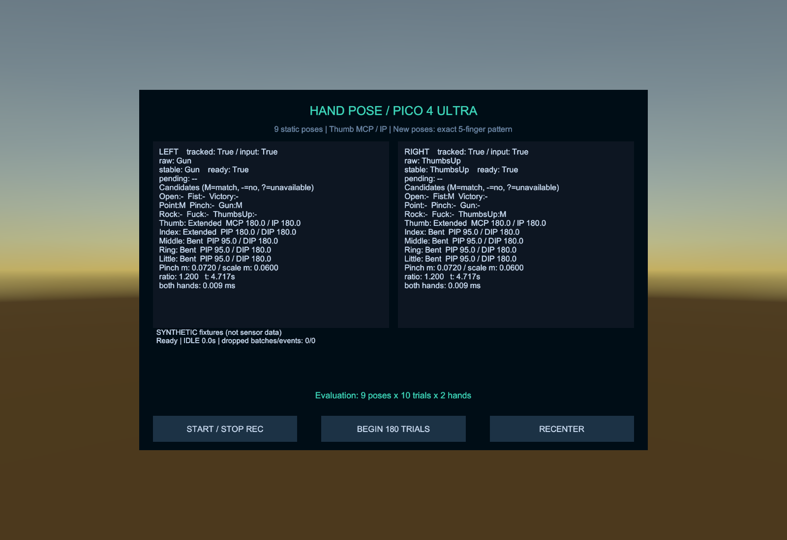
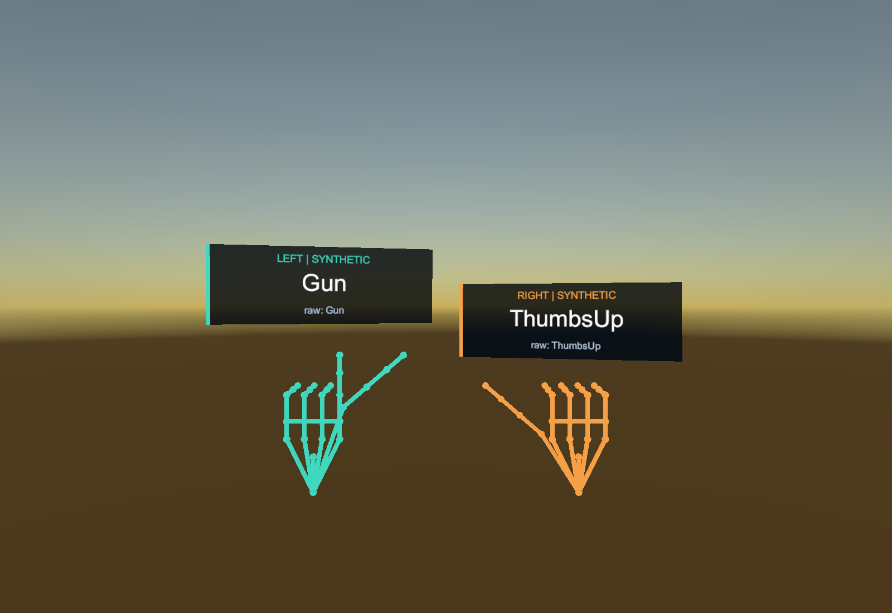
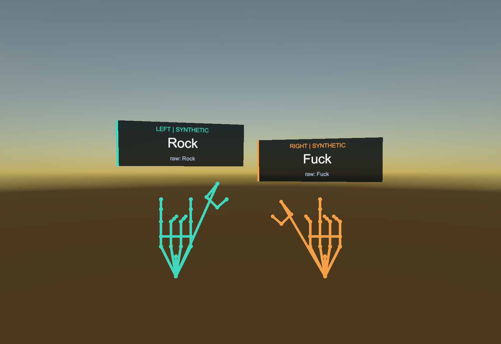

# 親指・9ポーズ対応の検証 — 2026-10-11

対象は `F:\LaboLatry\UItry`。Unity 6000.0.38f1、PICO Unity Integration SDK 3.4.0を使用しました。既存のXR Origin、手プレビュー、手元ラベルに新しい認識結果を接続しています。

## 親指の情報

親指のmetacarpal／proximal／distal／tip（JointId 2～5）は以前からネイティブ取得、joints.csv、骨格描画に含まれていました。今回、次の特徴量を追加しました。

- MCP内角：metacarpal → proximal → distal。
- IP内角：proximal → distal → tip。
- Extended／Bent／Intermediate／Invalidと、それぞれの角度の有効性。
- ダッシュボードのThumb行、poses.csvのthumb_state／thumb_mcp_deg／thumb_ip_deg。

設定アセットの `settings.thumb` で親指専用のしきい値を調整します。暫定値は両角度150度以上でExtended、どちらか125度以下でBent、その間はIntermediateです。親指にPIP／DIPという名称は使いません。角度による伸展は外転や世界座標の上方向を表しません。

## 追加ポーズと優先順

| ポーズ | Extended | Bent |
|---|---|---|
| Gun | 親指・人差し指 | 中指・薬指・小指 |
| Rock | 人差し指・小指 | 親指・中指・薬指 |
| Fuck | 中指 | 親指・人差し指・薬指・小指 |
| ThumbsUp | 親指 | 人差し指・中指・薬指・小指 |

指定されていない指をBentとする厳密な5指パターンです。IntermediateはBentとして扱いません。ThumbsUpの向きは条件にしません。

既存のOpen／Fist／Victory／Pointの親指自由、Pinchの距離条件を保持しています。GunとPoint、ThumbsUpとFistは両方が候補となります。初期優先順は `Pinch > Gun > ThumbsUp > Rock > Fuck > Point > Victory > Fist > Open` で、設定から変更できます。

既存PoseId番号を保持し、追加ポーズを7～10へ配置しました。候補の描画・保存・合成入力・試行指示・集計は共通の9ポーズ表を使います。評価指示は左右各9種類×10回の180試行です。

## 欠損・記録・互換性

新ルールの代表判定は4指の16点と親指の4点、計20点の有効性を要求します。親指が欠損・非有限・退化した場合はTrackingUnavailableです。4指だけで判定できる旧ルールの部分候補は診断用に残します。部分的なPinch一致は欠損後のヒステリシス履歴に持ち越しません。

新規CSVはschema_version=2、settings.rulesVersion=2です。既存のschema_version=1記録は保存時の5ルール・しきい値・優先順と親指自由の入力有効条件で再生し、追加4候補をUnavailableにします。旧5種類のライブ設定はしきい値・既存の順序を保持しながら9種類へ拡張します。

## ソフトウェア検証

- **Unity EditMode 61/61成功**。既存41件と追加20件。左右・回転・移動・3段階の尺度、親指の角度境界、欠損／NaN／Infinity／退化、全32通りのExtended/Bentパターン、新旧候補の競合と優先順、Pinch履歴、設定コピー、schema 1互換・schema 2記録再生を検証しました。
- **Python 8/8成功**。9ターゲットの左右集計、両スキーマ、未対応スキーマ拒否を含みます。
- 保存済みHandPoseDemoのPlayModeで左右それぞれ9ポーズを切り替え、安定判定・手元ラベルの一致と、ダッシュボードの親指MCP/IP・9候補を確認しました。
- `Samples/SyntheticSessionV2` は合成入力420バッチ、左右840手フレーム、26点×左右の関節21,840行、18の指示区間を含みます。脱落0、recording_complete=true。集計の指示区間はすべて成功しました。これはプログラムした合成形状の動作確認であり、実際の認識精度ではありません。
- PC Editorで両手の特徴量・ルール・安定化・イベント処理を計測しました。1000回ウォームアップ、5000回計測、中央値 **0.0036ms**、P95 **0.0050ms**。SDK取得、UI、ファイルI/Oを除きます。PICO端末の性能値ではありません。

表示例は合成骨格です。手の画像は検査用に一時的にカメラ位置とダッシュボードの表示を変え、シーンへ保存していません。

## Android成果物

`Builds/HandPose-PICO4Ultra-NinePoses.apk` は全9ポーズ対応版です。通常のビルドメニューから再生成する場合の名前は `Builds/HandPose-PICO4Ultra.apk` です。

- ARM64／IL2CPP、最低API 29、Target API 35、アプリID `com.labolatry.handpose`。
- ビルド成功、エラー0、警告12。SDK同梱Outlineシェーダーの警告を含みます。SDKソースは改変していません。
- APK Signature Scheme v2の検証成功。
- サイズ77,592,224バイト。
- SHA-256：`7B123E255719C306AF6D2427401653306D5A90C05791EEC3A7CA1220C6C0D8A0`。
- Core／Runtimeのソース・asmdef・デモシーン・設定の計22ファイルがビルド用コピーと一致しています。

ビルド結果・署名検証・SHA-256は `Builds/nine-poses-build-result.txt` に、ソース照合結果は `Validation/Logs/nine-poses-source-manifest.json` に保存しました。

検証用コピーでデバッグ署名を使い、元のプロジェクトの独自署名設定は保持しています。独自の鍵で導入済みのアプリを更新する場合は、元の署名設定で再ビルドしてください。

## 実機での確認が必要な項目

親指の実際の可動域、しきい値、追跡欠損、9ポーズの混同、左右差、手元ラベルの読みやすさ、端末上の処理・描画負荷は未確認です。標準Editor入力はSYNTHETICで、実際の手の入力はPICO上でAPKを実行して確認します。SDKソースは変更していません。

## 証跡

| ファイル | 内容 |
|---|---|
| Validation/Logs/thumb-editmode-final.xml | 最終61テストの結果 |
| Validation/Logs/thumb-editmode-final.log | コンパイル・EditModeログ |
| Validation/Logs/thumb-ui.log | 9ポーズ・親指UIのPlayModeログ |
| Validation/Logs/thumb-ui-smoke.txt | 手元ラベル・ダッシュボードの確認結果 |
| Validation/Logs/thumb-benchmark.txt | PC両手処理時間 |
| Validation/Logs/sample-analysis-v2/ | 9ポーズ合成記録の集計 |
| Validation/Logs/thumb-android-build.log | Androidビルドログ |
| Builds/nine-poses-build-result.txt | ビルド概要・署名・SHA-256 |
| Samples/SyntheticSessionV2/ | schema 2の合成サンプル |

前回の手プレビュー自体の検証は [HAND_PREVIEW_VALIDATION.md](HAND_PREVIEW_VALIDATION.md) を参照してください。
