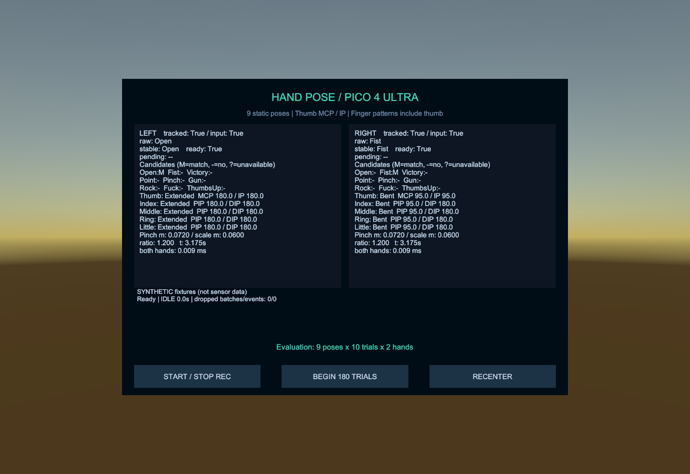
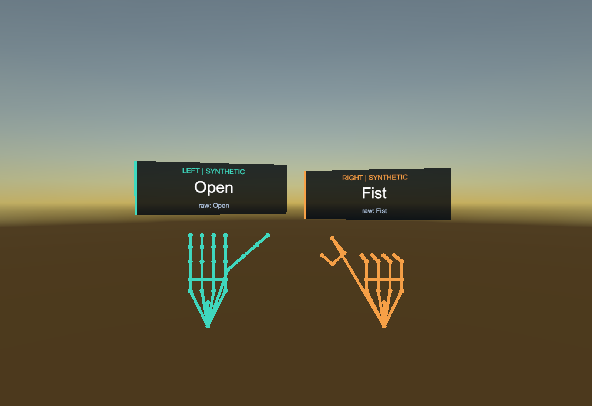

# 親指の状態を必須にした定義 — 2026-10-11

対象は `F:\LaboLatry\UItry`。Unity 6000.0.38f1／PICO Integration SDK 3.4.0の試作に、指定された親指条件を反映しました。

## 最新の定義

| ポーズ | 親指 | 人差し指 | 中指 | 薬指 | 小指 |
|---|---|---|---|---|---|
| Open | Extended | Extended | Extended | Extended | Extended |
| Fist | Bent | Bent | Bent | Bent | Bent |
| Victory | Bent | Extended | Extended | Bent | Bent |
| Point | Bent | Extended | Bent | Bent | Bent |
| Gun | Extended | Extended | Bent | Bent | Bent |
| Rock | Bent | Extended | Bent | Bent | Extended |
| Fuck | Bent | Bent | Extended | Bent | Bent |
| ThumbsUp | Extended | Bent | Bent | Bent | Bent |

Openは親指を含む5指すべてExtended、Fistは5指すべてBentです。Victory／Pointも親指Bentが必須です。GunとPoint、ThumbsUpとFistは親指の状態で区別し、同時には一致しません。IntermediateをExtended／Bentとして扱いません。親指に必要な位置が欠損・非有限・退化した場合、これら8候補はUnavailableになります。

Pinchの距離・ヒステリシス、左右独立の安定化、手プレビューと手元ラベルはそのまま使用します。Pinchと指状態の条件は重なる場合があるため、既存の優先順を保持します。親指のMCP/IPしきい値も150度／125度の暫定値を維持しています。

## 実装と記録

共通ポーズ表に親指条件を指定し、合成骨格もその条件に従って生成します。評価指示には各ポーズの親指Extended／Bentを表示します。新しいライブ判定は **rulesVersion=3**、既定の設定名は **3.0-thumb-required** です。旧ライブ設定はしきい値・既存優先順を保持して版3へ更新します。

CSVの列は変更せず、schema_version=2にルール版3を保存します。旧記録は保存時の版1／2を使い、Open／Fist／Victory／Pointの親指自由という当時の定義を再現します。最新の試用データは `Samples/SyntheticSessionV3`、過去のサンプルはV2およびSyntheticSessionに保持しています。

## 検
**EditMode 72/72成功**。従来61件を新定義に対応させ、親指必須条件について11件を追加しました。

- 左右それぞれでOpen／Fist／Victory／Pointの正しい親指・異なる親指・Intermediateを検証。
- 親指欠損時に4ポーズの候補がUnavailableになること、各ルールが親指を含む20点を要求することを検証。
- Gun／PointおよびThumbsUp／Fistが、優先順を入れ替えても正しく区別されることを検証。
- Extended／Bentの全32通りを、独立に指定した8ポーズの期待パターンと照合。
- 旧ライブ設定の更新、旧ルール版2のCSV再生、最新ルール版3の全9ポーズのCSV記録再生を検証。

保存済みHandPoseDemoのPlayModeで、左右それぞれ全9ポーズの安定判定と手元ラベルを確認しました。Openの親指Extended、Fist／Victory／Pointの親指Bent、GunとPoint・ThumbsUpとFistの候補が同時一致しないことも確認しています。表示例は検査用に一時的なカメラ位置・表示切替を使い、シーンへ保存していません。

最新の合成記録420バッチを集計し、左右各9種類の18指示区間すべてが想定どおりになりました。脱落0、recording_complete=trueです。この集計はプログラムした形状の動作確認であり、実際の手追跡の認識精度ではありません。

PICO実機の認識精度としきい値の調整は未確認です。Editorの標準入力・表示例は合成骨格です。

## 表示例と成果物

更新APK：`Builds/HandPose-PICO4Ultra-ThumbRequired.apk`（検証用デバッグ署名）。ビルド成功、エラー0、警告12。ARM64／IL2CPPとAPK Signature Scheme v2を確認しました。ビルド用コピーとCore／Runtimeのソース・asmdef・デモシーン・設定の計22ファイルが一致しています。

APKサイズは77,594,530バイト、SHA-256は `DA3E840F799E0F64ADA4DAF64885D697116BA8425592EF4403CE5D63CAFDDB38` です。ビルド概要は `Builds/thumb-required-build-result.txt` に保存しました。元のプロジェクトの独自署名設定は保持しています。

| 証跡 | 内容 |
|---|---|
| Validation/Logs/thumb-required-editmode.xml | 72テストの結果 |
| Validation/Logs/thumb-required-editmode.log | コンパイル・テストログ |
| Validation/Logs/thumb-required-ui.log | 保存済みデモシーンでの表示検証 |
| Validation/Logs/thumb-required-ui-smoke.txt | 全9ポーズの手元ラベル・親指条件の確認 |
| Validation/Logs/sample-analysis-v3/ | 最新の合成記録の集計 |
| Validation/Logs/thumb-required-android-build.log | Androidビルドログ |
| Validation/Logs/thumb-required-source-manifest.json | ビルド用コピーとのソース照合 |

前回の親指角度・4ポーズ追加については [THUMB_POSES_VALIDATION.md](THUMB_POSES_VALIDATION.md) を参照してください。そこに記載される親指自由の条件は旧ルール版2です。
